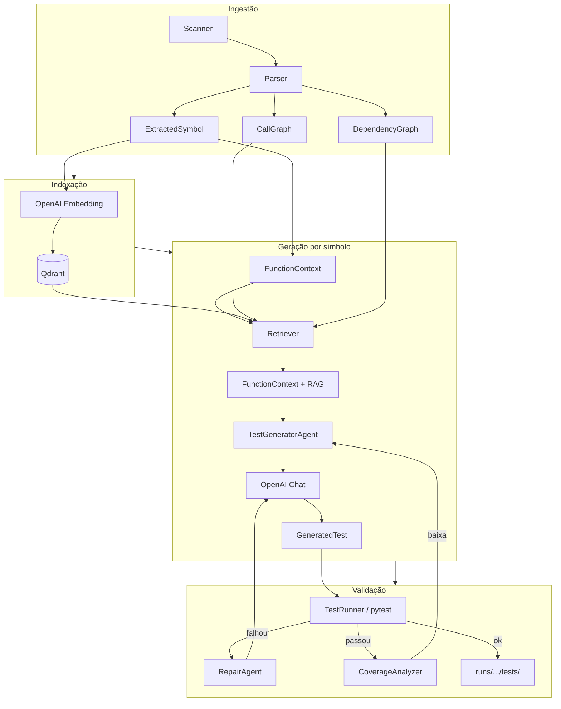

# Arquitetura

## Visão geral

O **RAG Test Engine** é um pipeline em fases orquestrado pelo `OrchestratorAgent`. Cada fase é independente e comunica-se via modelos Pydantic (`ExtractedSymbol`, `FunctionContext`, `GeneratedTest`).

## Entrypoint

```
main.py  →  OrchestratorAgent.run()  →  OrchestrationResult
```

A `main.py` não contém lógica de pipeline — apenas:

1. Faz parse de `SOURCE_DIR` via `argparse` (padrão: `"."`; use `--help` para ajuda)
2. Instancia `OrchestratorAgent`
3. Chama `orchestrator.run(source_dir)`
4. Retorna `OrchestrationResult`

Detalhes dos argumentos: [CLI.md](CLI.md)

```python
# main.py (simplificado)
def main(source_dir: str = ".") -> OrchestrationResult:
    orchestrator = OrchestratorAgent()
    return orchestrator.run(source_dir)
```



## Fases do pipeline

### 1. Ingestão

**Entrada:** caminho do diretório fonte (`SOURCE_DIR`)

**Módulos:** `ingest/scanner.py`, `ingest/parser.py`, `ingest/extract.py`

1. `RepositoryScanner` varre `*.py`, ignorando `.git`, `__pycache__`, `venv`, etc.
2. Cada arquivo é parseado em AST (`ast_utils.py`).
3. `SymbolExtractor` produz `ExtractedSymbol` (função, método ou classe).
4. Coletores AST extraem imports, branches, exceções e dependências.
5. `CallGraphBuilder` e `DependencyGraphBuilder` constroem grafos estruturais.

**Saída:** lista de símbolos + grafos, persistidos em `artifacts/`.

### 2. Indexação

**Módulo:** `retrieval/retriever.py`, `retrieval/embeddings.py`

1. Para cada símbolo, monta documento textual (`embedding_builder.py`).
2. Gera embedding via `OpenAIEmbedding` (ou `LocalEmbedding` em modo offline).
3. Faz upsert no Qdrant (`QdrantStore`) na coleção `symbols`.
4. Com `REINDEX_SYMBOLS=false`, símbolos inalterados são pulados (hash de conteúdo).

**IDs estáveis:** UUID-5 derivado do `qualified_name` — reindexação não duplica pontos.

### 3. Enriquecimento RAG

**Módulo:** `retrieval/retriever.py`, `retrieval/hybrid.py`

Para cada símbolo alvo:

1. Obtém vetor de consulta (cache do Qdrant ou nova chamada de embedding).
2. Busca ANN na coleção `symbols` (pool de `RETRIEVER_RERANK_POOL_SIZE` candidatos).
3. Coleta vizinhos do call graph (callers/callees) e dependency graph.
4. Reordena com score híbrido:

```
score = 0.5 × similaridade_vetorial
      + 0.3 × dependency_score
      + 0.2 × call_graph_score
```

5. Busca testes similares na coleção `tests` (se existir).
6. Preenche `FunctionContext.retrieval_context`.

### 4. Geração de testes

**Módulo:** `agents/test_generator.py`

1. `FunctionContext.to_prompt_block()` formata contexto estruturado.
2. `TestGeneratorAgent` envia system + user prompt ao LLM.
3. Resposta é parseada (`_parse_response`): remove markdown, extrai imports.
4. `import_utils.normalize_test_imports()` corrige caminhos de importação.

**Imports:** usa `module_name` relativo à raiz do projeto (ex.: `from mockes.exemplo import Calculadora`). O `import_utils.normalize_test_imports()` corrige imports incorretos gerados pelo LLM. O `PYTHONPATH` na execução aponta para a raiz do repositório (`config.settings.ROOT`).

### 5. Execução

**Módulo:** `execution/runner.py`

1. `TestRunner` escreve `GeneratedTest.full_code` em arquivo temporário.
2. Executa `pytest -v --noconftest` com `PYTHONPATH` na raiz do projeto.
3. Retorna `RunResult` (passed, stdout/stderr, contagens).

### 6. Reparo

**Módulo:** `agents/repair.py`

Se `RunResult.passed == False`:

1. Monta prompt com contexto, código falho e saída do pytest.
2. `RepairAgent` pede correção ao LLM.
3. Reexecuta pytest (até `max_repairs`, padrão 2).

### 7. Cobertura

**Módulo:** `execution/coverage_analyzer.py`

Se o teste passou e `MAX_COVERAGE_ROUNDS > 0`:

1. `CoverageAnalyzer` mede cobertura da função alvo.
2. Se abaixo de `COVERAGE_THRESHOLD`, injeta lacunas em `FunctionContext`.
3. Regenera teste e revalida (com loop de reparo se necessário).

### 8. Persistência

**Módulo:** `config/run_workspace.py`

Cada execução cria `runs/<slug>/<timestamp>/`:

| Pasta/arquivo | Conteúdo |
|---|---|
| `tests/` | Arquivos `test_<symbol>.py` aprovados |
| `logs/pipeline.log` | Log com timestamp |
| `artifacts/symbols.json` | Símbolos extraídos |
| `artifacts/call_graph.json` | Grafo de chamadas |
| `artifacts/dependency_graph.json` | Grafo de dependências |
| `artifacts/run_meta.json` | Metadados iniciais |
| `artifacts/run_summary.json` | Stats + tokens ao final |

## Modos de operação

### `AI_MODE=openai` (padrão)

- LLM: `OpenAILLM` (`gpt-5-nano` por padrão)
- Embeddings: `OpenAIEmbedding` (`text-embedding-3-small`)
- Rastreamento de tokens via `UsageTracker`

### `AI_MODE=offline`

- LLM: `MockLLM` (testes mínimos determinísticos)
- Embeddings: `LocalEmbedding` (vetores hash, sem API)
- Útil para validar pipeline sem custo

## Modelos de dados principais

| Modelo | Arquivo | Papel |
|---|---|---|
| `ExtractedSymbol` | `ingest/models/ExtractedSymbol.py` | Símbolo extraído do AST |
| `FunctionContext` | `schemas/context.py` | Entrada do gerador (código + RAG) |
| `RetrievalContext` | `schemas/retrieval_context.py` | Contexto RAG híbrido |
| `GeneratedTest` | `schemas/outputs.py` | Arquivo pytest estruturado |
| `RunResult` | `execution/runner.py` | Resultado do pytest |
| `PipelineStats` | `schemas/pipeline.py` | Contadores da execução |
| `OrchestrationResult` | `schemas/pipeline.py` | Resultado final do orchestrator |

## Extensibilidade

| Ponto | Como estender |
|---|---|
| LLM | Implementar `BaseLLM`, registrar em `llm/factory.py` |
| Embeddings | Implementar `BaseEmbedding`, registrar em `llm/factory.py` |
| Coletores AST | Novos collectors em `ingest/collectors/` |
| Score híbrido | Pesos em `RETRIEVER_*_WEIGHT` no `.env` |
| Pipeline | Injetar dependências em `OrchestratorAgent(...)` |
