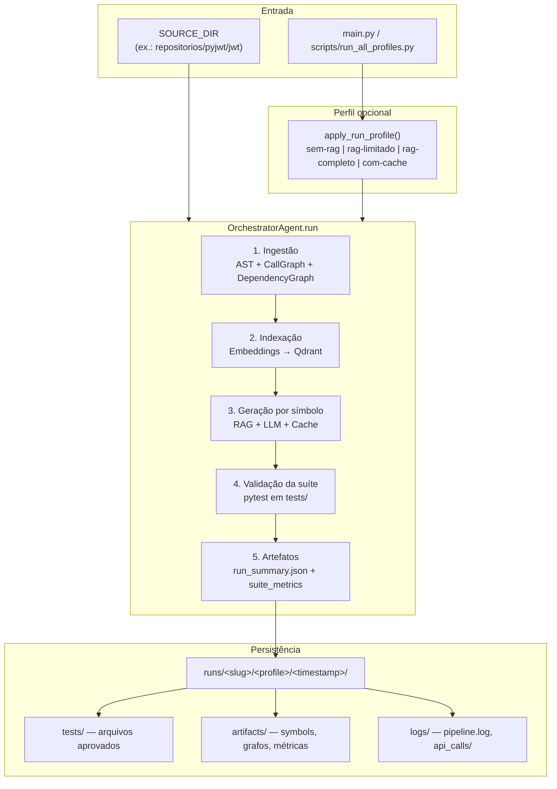
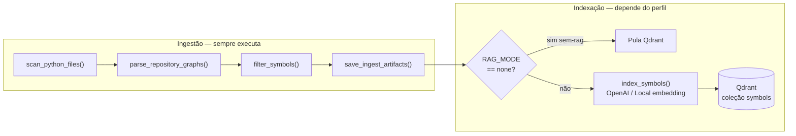
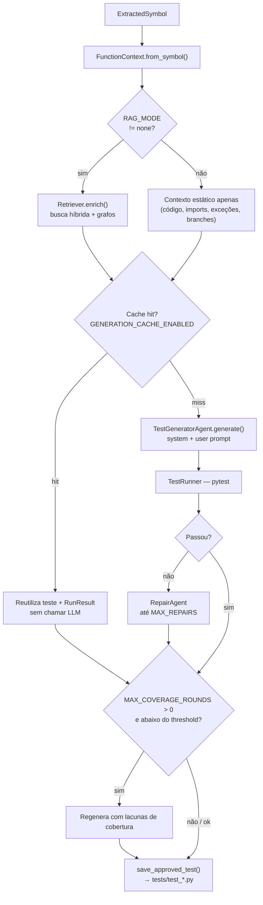
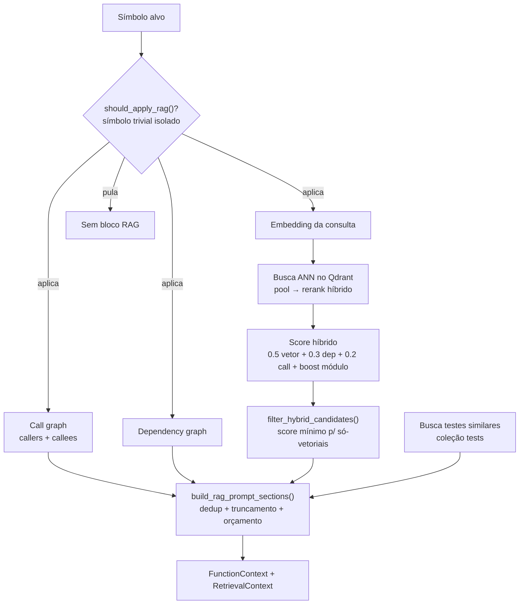
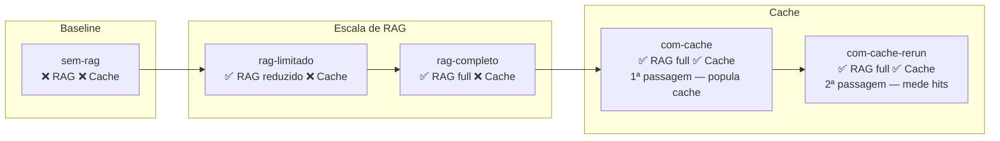
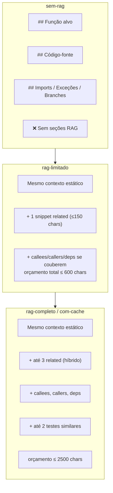
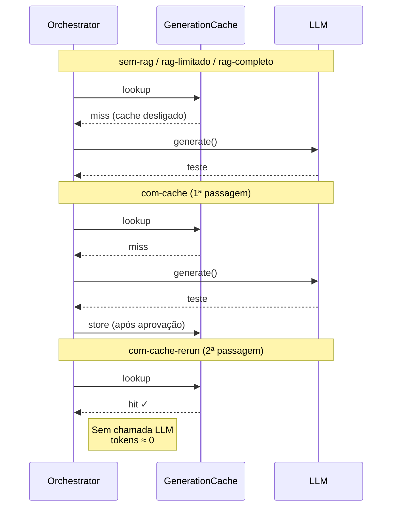
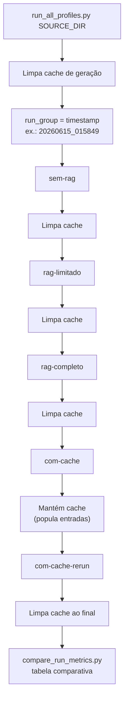
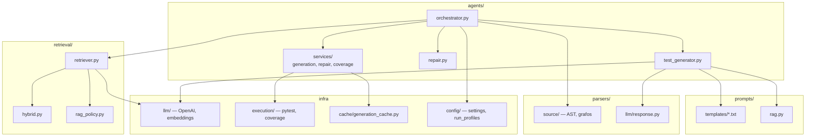

# Fluxogramas — arquitetura e experimentos

Diagramas da arquitetura do **RAG Test Engine** e das diferenças entre os perfis de experimento (`--profile`).

---

## 1. Visão geral do pipeline



**Ponto de entrada:** `main.py` instancia `OrchestratorAgent` e chama `.run(source_dir)`.

**Saída:** `OrchestrationResult` + workspace em `runs/`.

---

## 2. Fase de ingestão e indexação



| Artefato | Conteúdo |
|---|---|
| `symbols.json` | Todos os símbolos extraídos |
| `call_graph.json` | Quem chama quem |
| `dependency_graph.json` | Dependências estruturais |
| `ingest_selection.json` | Símbolos incluídos/ignorados |

---

## 3. Loop por símbolo (núcleo do experimento)

Cada função/método elegível passa pelo fluxo abaixo. **O perfil altera principalmente os blocos RAG e Cache.**



---

## 4. Enriquecimento RAG (quando ativo)



---

## 5. Perfis de experimento — comparação

Os perfis são presets em `config/run_profiles.py`. Cada um isola uma variável para comparação justa.



### Tabela comparativa

| Perfil | `RAG_MODE` | Indexação Qdrant | Contexto no prompt | Cache de geração | Objetivo do experimento |
|---|---|---|---|---|---|
| **sem-rag** | `none` | ❌ Pulada | Só análise estática (AST, exceções, branches) | ❌ | **Baseline** — quanto o LLM resolve sem contexto externo |
| **rag-limitado** | `limited` | ✅ | RAG com orçamento reduzido (600 chars total, 1 snippet) | ❌ | **Custo/benefício** — RAG mínimo ainda ajuda? |
| **rag-completo** | `full` | ✅ | RAG completo (2500 chars, top-3 related, grafos) | ❌ | **Máximo RAG** — teto de qualidade sem cache |
| **com-cache** | `full` | ✅ | Igual rag-completo | ✅ (popula) | **Cache frio→quente** — 1ª execução grava entradas no cache |
| **com-cache-rerun** | `full` | ✅ | Igual rag-completo | ✅ (reutiliza) | **Medir hits** — 2ª execução; compara tokens/tempo vs com-cache |

### Overrides do `rag-limitado`

| Variável | Padrão (`rag-completo`) | `rag-limitado` |
|---|---|---|
| `PROMPT_MAX_RAG_TOTAL_CHARS` | 2500 | **600** |
| `PROMPT_MAX_RAG_SNIPPET_CHARS` | 300 | **150** |
| `RETRIEVER_TOP_K_FUNCTIONS` | 3 | **1** |
| `RETRIEVER_TOP_K_TESTS` | 2 | **1** |
| `RETRIEVER_RERANK_POOL_SIZE` | 10 | **5** |

### O que muda no prompt do LLM



### O que muda no cache (`com-cache` vs demais)



---

## 6. Protocolo de lote (`run_all_profiles.py`)

Compara os 5 perfis em sequência dentro do mesmo `run_group`.



### Protocolo `fair` (padrão)

| Passo | Perfil | Cache após execução | Por quê |
|---|---|---|---|
| 1 | sem-rag | Limpa | RAG comparado sem resíduo |
| 2 | rag-limitado | Limpa | Idem |
| 3 | rag-completo | Limpa | Idem |
| 4 | com-cache | **Mantém** | Popula cache para a 2ª passagem |
| 5 | com-cache-rerun | Limpa | Mede hits; limpa para próximo lote |

### O que comparar nos resultados

| Comparação | Perfis | Métrica principal |
|---|---|---|
| **RAG ajuda?** | sem-rag vs rag-limitado vs rag-completo | `ok`, `repaired`, `failed`, tokens |
| **RAG limitado basta?** | rag-limitado vs rag-completo | Qualidade vs custo de tokens |
| **Cache economiza?** | com-cache vs com-cache-rerun | `generation_cache.hits`, tokens, tempo |
| **Suíte executável?** | Todos | `suite_metrics`, validação pytest final |

Layout de saída:

```
runs/<slug>/<run_group>/
├── sem-rag/
├── rag-limitado/
├── rag-completo/
├── com-cache/
└── com-cache-rerun/
```

---

## 7. Mapa de módulos



---

## Comandos rápidos

```bash
# Um perfil
uv run python main.py repositorios/pyjwt/jwt --profile rag-completo

# Lote completo (5 experimentos)
uv run python scripts/run_all_profiles.py repositorios/pyjwt/jwt

# Comparar métricas
uv run python scripts/compare_run_metrics.py runs/repositorios_pyjwt_jwt/<run_group>
```

## Referências

- [ARCHITECTURE.md](ARCHITECTURE.md) — descrição textual das fases
- [PROMPTS_AND_TECHNIQUES.md](PROMPTS_AND_TECHNIQUES.md) — prompts e técnicas RAG
- [RAG_TUNING.md](RAG_TUNING.md) — ajuste fino e protocolo de avaliação
- [CLI.md](CLI.md) — argumentos e layout de `runs/`
